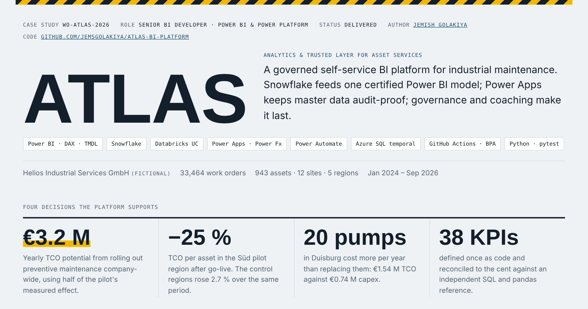
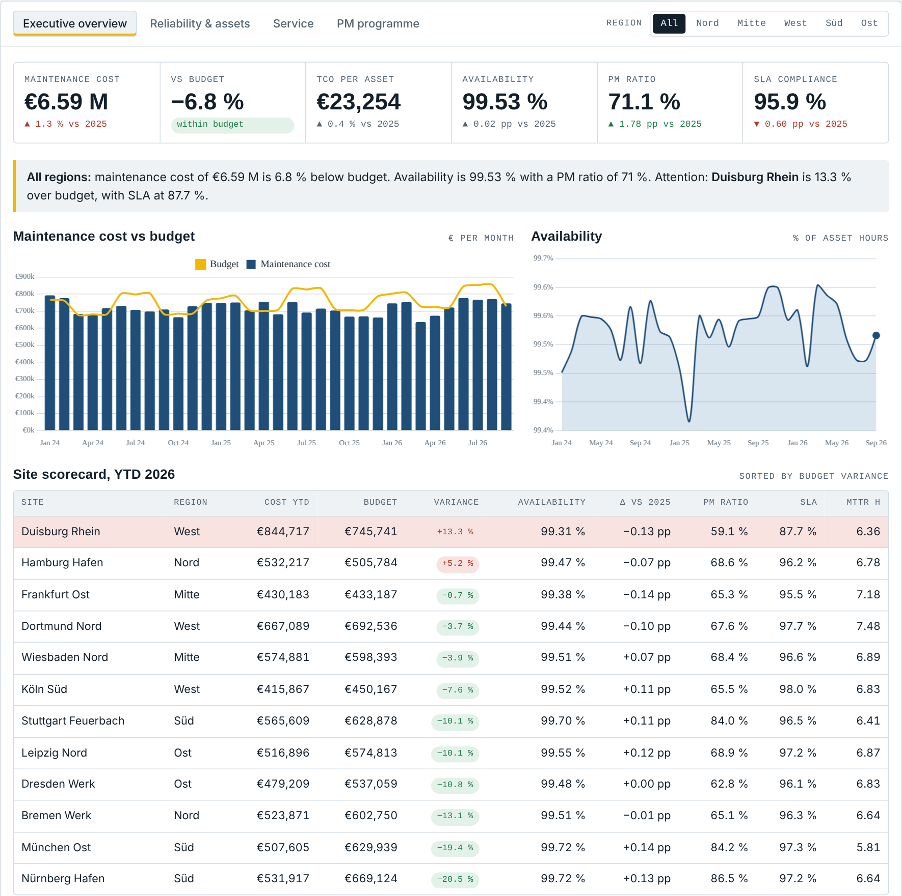
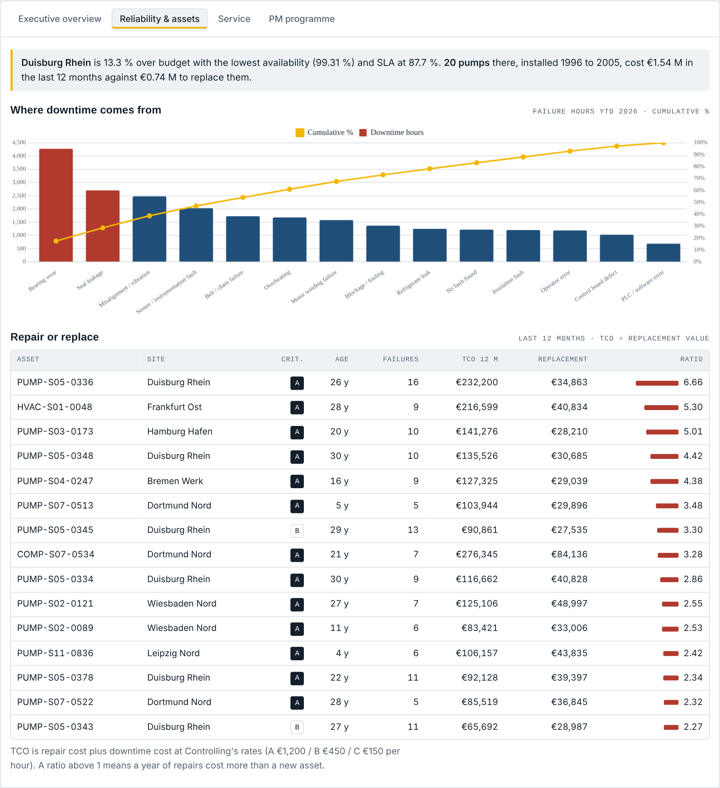
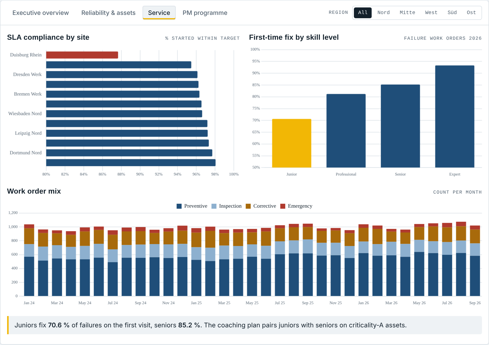
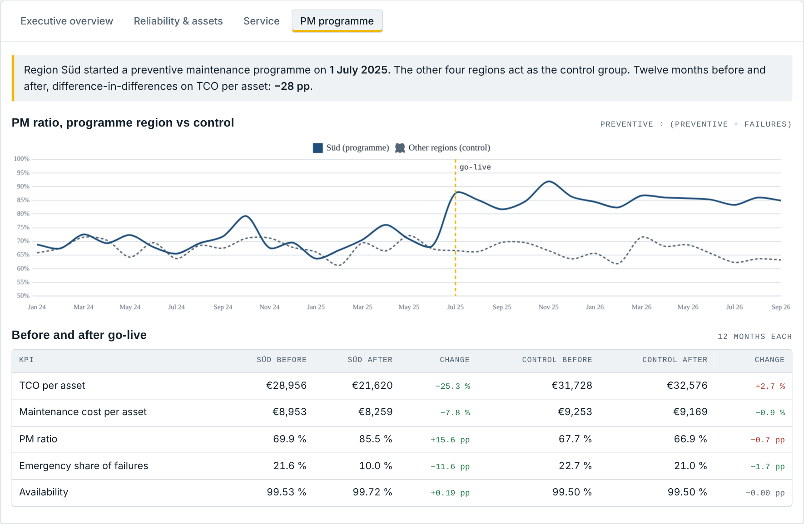
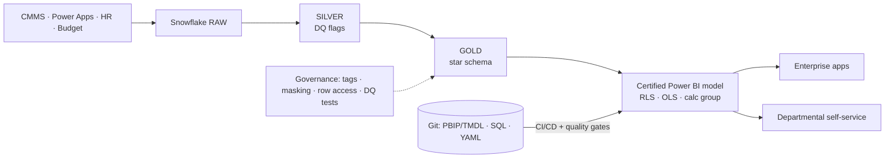

# ATLAS · Analytics & Trusted Layer for Asset Services

*A governed self-service BI platform: Snowflake → certified Power BI model → Power Platform, with the governance and coaching to run it.*

**Author:** Jemish Golakiya · Power BI & Data Analytics · Frankfurt am Main · [LinkedIn](https://www.linkedin.com/in/golakiya-jemish) · [GitHub](https://github.com/jemsgolakiya)

A complete, reproducible portfolio project for a fictional industrial maintenance company, *Helios Industrial Services GmbH* (12 German sites, 943 assets, 33,464 work orders, Jan 2024 – Sep 2026). It shows how I would build, govern and grow an enterprise Power BI platform, and which business decisions it enables.

> **Live showcase:** interactive dashboard preview + project overview → open [`showcase/index.html`](showcase/index.html) in a browser (self-contained, no install)

    [](https://github.com/jemsgolakiya/atlas-bi-platform/actions/workflows/powerbi-ci-cd.yml)

---

## Dashboard preview

<p align="center"></p>

| Executive overview | Reliability & assets |
|---|---|
|  |  |
| **Service** | **PM programme** |
|  |  |

*Screens from the interactive showcase, a web rendition of the Power BI report built on the same data and the same KPI definitions.*

## Kurzfassung (Deutsch)

ATLAS ist eine durchgängige, governte Self-Service-BI-Plattform für ein (fiktives) Instandhaltungsunternehmen mit 12 Standorten, 943 Anlagen und 33.464 Arbeitsaufträgen.

- **Datenplattform:** Snowflake (RAW → SILVER → GOLD) mit SCD2-Historie, Masking- und Row-Access-Policies sowie automatisierten Datenqualitätstests; zusätzlich eine Databricks-Variante (Unity Catalog)
- **Power BI:** zertifiziertes semantisches Modell im Sternschema, 38 KPIs als Code, RLS/OLS und eine Calculation Group für Zeitintelligenz
- **Power Platform:** revisionssichere CRUD-App (Power Apps) auf Azure-SQL-Temporal-Tables mit Vier-Augen-Prinzip, Freigabe-Flows mit Power Automate
- **Governance:** Lifecycle DEV → TEST → PROD, Berechtigungskonzept, Best Practice Analyzer und KPI-Abgleich in der CI/CD-Pipeline
- **Self-Service & Coaching:** vierstufiges Schulungsprogramm und Workshop-Kit für Fachbereiche

**Ergebnis:** Das Pilotprogramm zur vorbeugenden Instandhaltung senkte die TCO pro Anlage um 25 % (Potenzial ca. 3,2 Mio. € pro Jahr). 20 alte Pumpen in Duisburg kosten im Betrieb mehr als ihr Ersatz.

---

## Results first

| Decision supported | Evidence | Value |
|---|---|---|
| Roll out preventive maintenance company-wide | Difference-in-differences: pilot region TCO per asset **−25 %**, control **+2.7 %** | **≈ €3.2 M p.a.** TCO potential (half the measured effect) |
| Replace 20 end-of-life pumps in Duisburg | 12-month TCO **€1.54 M** vs. replacement **€0.74 M** | payback < 6 months |
| Condition monitoring for bearings & seals | 28.6 % of all failure downtime | pilot on criticality-A assets |
| Pair junior with senior technicians | First-time fix 70.6 % vs 85.2 % | fewer repeat visits |

Details: [`docs/06_insights_and_recommendations.md`](docs/06_insights_and_recommendations.md)

---

## Job requirements → where to find them

| Requirement | Deliverable |
|---|---|
| Complex reports, dashboards & datasets in Power BI | Star schema, [38 certified measures as code](powerbi/semantic-model/measures.yaml), [calc group + RLS/OLS](powerbi/semantic-model/model_objects.tmdl), [Power Query](powerbi/power-query/atlas_queries.pq), [report blueprint](powerbi/report/REPORT_BLUEPRINT.md), [theme](powerbi/theme/atlas_theme.json) |
| Consulting departments on reporting design | [Requirements workshop kit & report canvas](docs/05_requirements_workshop_kit.md) |
| Unified, sustainable governance | [Governance framework](docs/02_governance_framework.md): roles/RACI, content tiers, naming, lifecycle, access control, certification, monitoring |
| Power Platform integration | [Power Platform concept](docs/04_power_platform.md): CRUD app, 3 flows, environments, DLP, ALM |
| Self-service BI with coaching | [Coaching programme](docs/03_self_service_coaching.md): 4-level maturity path, curriculum, champions, adoption KPIs |
| Audit-proof CRUD apps | [Power Fx source](powerplatform/asset-master-data-app/POWER_FX_SOURCE.md) + [Azure SQL temporal tables, 4-eyes approval](sql/azure-sql/master_data_crud_audit.sql) |
| DAX expertise | TREATAS, WINDOW, Pareto, dynamic narrative, ratio-aware calc group → [KPI catalogue](docs/07_kpi_catalogue.md) |
| SQL: Snowflake / Databricks | [Snowflake 00–06](sql/snowflake/) (RBAC, dynamic tables, SCD2, masking, row access, DQ, analytics) · [Databricks Unity Catalog](sql/databricks/unity_catalog_equivalent.sql) |
| Lifecycle & access control | [CI/CD pipeline](.github/workflows/powerbi-ci-cd.yml), [BPA rules](governance/bpa/BPARules.json), [deployment & admin scripts](governance/scripts/) |

---

## Architecture



More: [`docs/01_architecture.md`](docs/01_architecture.md) (layer responsibilities and 7 architecture decision records).

## Quality gates (why the numbers can be trusted)

1. **Measures as code:** `measures.yaml` generates TMDL, DAX query view script and the business KPI catalogue. CI fails if they drift.
2. **Independent reference:** `scripts/kpi_reference.py` recomputes every KPI in pandas; `tests/test_reference_kpis.py` proves the gold layer matches.
3. **Best Practice Analyzer:** 14 rules (performance, DAX, naming, descriptions, PII protection).
4. **Data quality:** 9 Snowflake tests, ERROR severity blocks the deployment.
5. **Post-deploy reconciliation:** `tests/reconcile_dax.py` queries the published model via REST API; > 0.1 % deviation fails the release.

---

## Run it locally (≈ 2 minutes, no cloud account)

```bash
pip install -r requirements.txt
python scripts/generate_data.py            # seeded synthetic source data  -> data/
python scripts/build_gold.py               # gold layer, same columns as Snowflake GOLD -> data/gold/
python scripts/kpi_reference.py            # reference KPIs + showcase data
python scripts/generate_measure_artifacts.py
python -m pytest tests -q                  # 5 passed
python scripts/build_showcase.py           # showcase/index.html
```

Then build the Power BI model in ~15 minutes following [`powerbi/README.md`](powerbi/README.md) (Power Query parameter `DataSource = "LocalCSV"`). To run against Snowflake, execute `sql/snowflake/00…06` in order and switch the parameter to `"Snowflake"`. Saving the model as **.pbip** to `powerbi/ATLAS.SemanticModel/` enables the BPA step in CI.

## Repository

```
├── data/                    seeded synthetic CSVs (+ data/gold for local Power BI)
├── sql/snowflake/           00 RBAC · 01 raw · 02 silver · 03 gold · 04 security · 05 DQ · 06 analytics
├── sql/databricks/          Unity Catalog equivalent (Delta MERGE SCD2, row filters, column masks)
├── sql/azure-sql/           audit-proof CRUD back end (temporal tables, 4-eyes principle)
├── powerbi/                 Power Query · measures.yaml → TMDL/DAX · roles · calc group · theme · blueprint
├── powerplatform/           Power Apps (Power Fx) source of the master data app
├── governance/              BPA rules · tenant inventory · deployment & refresh scripts
├── .github/workflows/       CI/CD pipeline
├── tests/                   pytest on gold layer · post-deploy DAX reconciliation
├── showcase/                interactive one-page case study (data embedded)
└── docs/                    01 architecture … 07 KPI catalogue
```

## Docs

[01 Architecture](docs/01_architecture.md) · [02 Governance](docs/02_governance_framework.md) · [03 Coaching](docs/03_self_service_coaching.md) · [04 Power Platform](docs/04_power_platform.md) · [05 Workshop kit](docs/05_requirements_workshop_kit.md) · [06 Insights](docs/06_insights_and_recommendations.md) · [07 KPI catalogue](docs/07_kpi_catalogue.md)

---

Licensed under the [MIT License](LICENSE).

*All company names, people and figures are synthetic (seed 42). The project is built to be inspected: every number in the docs and the showcase can be regenerated and tested.*

---

## About me

I'm **Jemish Golakiya**, a data analyst focused on Power BI, DAX, SQL (Snowflake / Databricks) and the Power Platform, based in Frankfurt am Main. I built ATLAS to show how I design, govern and roll out an enterprise BI platform end to end, from the data model to the people who use it.

📫 Let's talk: [LinkedIn](https://www.linkedin.com/in/golakiya-jemish)
