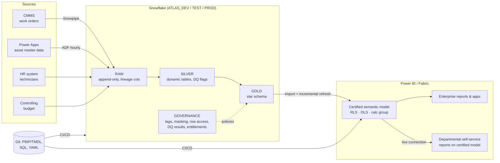

# 01 · Architecture

## Layer responsibilities

| Layer | Responsibility | Never does |
|---|---|---|
| RAW | Exact copy of source + file name, row number, load time | Transform, delete |
| SILVER | Typing, de-duplication, DQ flags (`DQ_STATUS`, `DQ_REASONS`) | Drop rows silently |
| GOLD | Star schema, surrogate & point-in-time keys, row-level business logic (durations, cost) | Aggregations that depend on filter context |
| Semantic model | Aggregations, ratios, time intelligence, RLS/OLS, business names | Row-level transformations |
| Reports | Visualisation, navigation, storytelling | Business logic in visual-level calculations |

## Key design decisions (ADR summary)

| # | Decision | Alternatives | Reason |
|---|---|---|---|
| ADR-01 | Snowflake dynamic tables for SILVER/GOLD | dbt, stored procedures + tasks | Declarative, incremental, freshness SLA per table (`TARGET_LAG`); dbt is the next step when the team grows |
| ADR-02 | Import mode + incremental refresh | DirectQuery, Direct Lake | Best interactive performance at this volume; DirectQuery only for the hourly backlog page |
| ADR-03 | One DB per stage (DEV/TEST/PROD) | Schemas per stage | Same scripts, clean grants, mirrors Power BI deployment pipeline |
| ADR-04 | Entitlement table shared by Snowflake RAP and Power BI RLS | Separate role definitions | Access defined, approved and audited once |
| ADR-05 | Measures-as-code (YAML → TMDL/DAX/docs) | Editing in Desktop only | Reviewable, testable, generates the business glossary |
| ADR-06 | Azure SQL temporal tables for the CRUD app | Dataverse | Tamper-proof history by engine, SQL skills in team, easy sync (see `04_power_platform.md`) |
| ADR-07 | Databricks-ready design | Snowflake-only | Same medallion + UC row filters/masks (`sql/databricks/`) — no lock-in |
