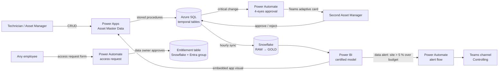

# 04 · Power Platform integration

Power BI shows what happened. The rest of the Power Platform closes the loop: **capture correct data (Power Apps) → automate decisions (Power Automate) → act from the report (Power BI)**.

---

## 1 · CRUD app: Asset Master Data (audit-proof)

Full Power Fx source: [`powerplatform/asset-master-data-app/POWER_FX_SOURCE.md`](../powerplatform/asset-master-data-app/POWER_FX_SOURCE.md) · back-end: [`sql/azure-sql/master_data_crud_audit.sql`](../sql/azure-sql/master_data_crud_audit.sql)

| Requirement ("revisionssicher") | How it is met |
|---|---|
| Every change is traceable | SQL **system-versioned temporal tables**: the database, not the app, writes history. It cannot be bypassed or edited. |
| Who / when / why | `ChangedBy` (Entra UPN) and a mandatory `ChangeReason` (≥ 10 chars) on every write; `ValidFrom` set by the engine in UTC. |
| No data loss | No `DELETE` permission at all. Deactivation is a soft delete and itself requires approval. |
| 4-eyes principle | Criticality, site and deactivation changes are queued in `AssetChangeRequest`; a CHECK constraint makes self-approval impossible. |
| Least privilege | App identity has `EXECUTE` on procedures and `SELECT` on views only; explicit `DENY` on table writes. |
| Concurrency | `ROWVERSION` check → "record changed by another user, please reload" instead of silent overwrite. |
| Retention | History retained 10 years (`HISTORY_RETENTION_PERIOD`) in line with GoBD / §147 AO. |
| Point-in-time audit | `FOR SYSTEM_TIME AS OF '2026-06-30'` shows master data as it was at any past date. |

**Why Azure SQL and not Dataverse?** Both work; the decision is documented as an ADR:

| Criterion | Dataverse | Azure SQL (chosen) |
|---|---|---|
| Built-in auditing | ✅ (audit log, retention configurable) | ✅ temporal tables — tamper-proof by engine |
| Licensing | Premium per user / per app | Premium connector anyway; DB cost ~ €15/month |
| Reuse by Snowflake / other systems | Synapse Link / Fabric link | Direct, standard ODBC/ADF |
| Complex validation (4-eyes, concurrency) | Plug-ins / business rules | Stored procedures, constraints |
| Team skillset | Low-code | SQL (strong in the BI team) |

For departments without SQL skills and smaller entities (e.g. checklists), **Dataverse** is the default — the platform offers both patterns.

---

## 2 · Power Automate flows

### a) Critical change approval (4-eyes)

| Step | Action |
|---|---|
| Trigger | *When an item is created* (SQL) on `md.AssetChangeRequest` (or recurrence every 5 min polling `Status = 'Pending'`) |
| 1 | Get asset details from `md.vAsset` |
| 2 | **Start and wait for an approval** (type: *First to respond*) assigned to the `sg-atlas-asset-managers` group **excluding the requester** (filter array on members) — adaptive card in Teams with old/new value and reason |
| 3 | Execute stored procedure `md.usp_ChangeRequest_Decide(RequestId, Outcome, Approver UPN)` |
| 4 | Notify requester in Teams (approved / rejected + approver comment) |
| Error handling | *Configure run after → has failed* scope: post to the BI support channel with the run URL; timeout 5 days → escalate to Head of Asset Management |

### b) Data-driven alert from Power BI

Power BI data alert on the card `Budget Variance %` per site (threshold 5 %) → flow posts an adaptive card to the Controlling Teams channel with the site, value, a deep link to the *Site Detail* page (pre-filtered URL) and an "Acknowledge" button that writes back to a SharePoint list for follow-up tracking.

### c) Access request & quarterly re-certification

Microsoft Form → Data Owner approval → on approval: insert into `ATLAS_GOVERNANCE.SECURITY.REGION_ENTITLEMENT` (with ticket ID + expiry) and add the user to the Entra ID group (Graph connector) → confirmation mail. Quarterly: recurrence flow sends each Data Owner the list of active grants as an approval; un-confirmed grants are expired automatically.

---

## 3 · Power Platform governance (ALM & environments)

| Topic | Standard |
|---|---|
| Environments | `ATLAS-Dev`, `ATLAS-Test`, `ATLAS-Prod` (Managed Environments enabled); Default environment for personal productivity only |
| Solutions | Everything in a **solution**; unmanaged in Dev, **managed** in Test/Prod; environment variables for SQL server/database; connection references instead of personal connections |
| Pipelines | Power Platform Pipelines (or `pac solution` in GitHub Actions) Dev → Test → Prod with approval |
| DLP policies | *Business* group: SQL Server, Snowflake, Office 365, Teams, Approvals, SharePoint, Power BI. *Blocked*: consumer social / file-sharing connectors. HTTP connector only in Dev |
| Ownership | Apps/flows owned by a **service account**, co-owned by the department's Champion; no production flow owned by an individual |
| Monitoring | CoE Starter Kit: inventory of apps/flows/makers, orphaned resources, unused apps → same monthly Governance Board review as Power BI |

---

## 4 · Further Power Platform integration on the roadmap

* **Power Apps visual in Power BI**: technicians correct a wrong failure code *from the report* (write-back), the report refreshes the row via DirectQuery on the backlog table.
* **Copilot / AI Builder**: classify free-text work-order descriptions into failure codes to improve the Pareto analysis (human-in-the-loop review in the app).
* **Fabric Data Activator** for real-time sensor thresholds once IoT data lands in OneLake.
